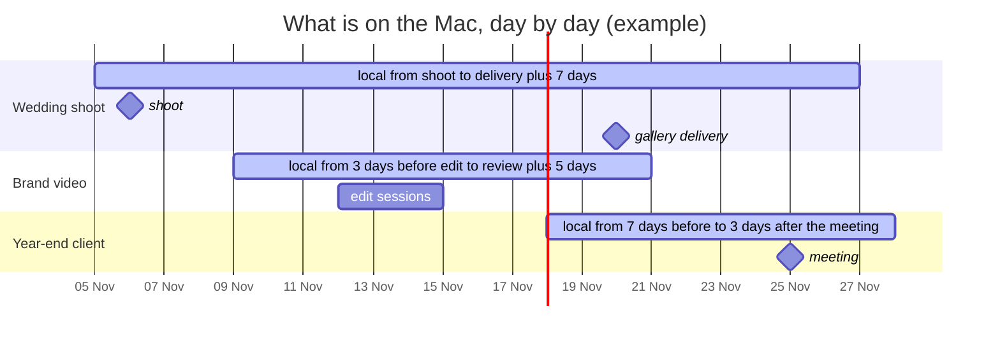

# Evict-Planner


**Your data no longer fits on your laptop. You don't need all of it at once — but you need each piece
of it at a planned time, instantly.** Evict-Planner is a blueprint for a *calendar-driven local window*:
files come down to the Mac before you need them, stay while you work, and go back to iCloud Drive or a
NAS when you are done.

[Türkçe README](README.tr.md)

> **What this repository is:** an outline and a set of ideas, not a turnkey product. It describes the
> pattern, the moving parts, the macOS building blocks and the safety gates learned from running such a
> system on a large archive (hundreds of GB, 100k+ files). **You write the rules.** The intended reader is
> anyone who wants to build their own version — a developer, or a "vibe coder" working with an AI assistant.
> Four worked examples live in [`examples/`](examples/).

---

## Contents

- [Is this for you?](#is-this-for-you)
- [The idea](#the-idea)
- [Four people, one pattern](#four-people-one-pattern)
- [How much disk will it free?](#how-much-disk-will-it-free)
- [How it works — one run](#how-it-works--one-run)
- [Turning a calendar into windows](#turning-a-calendar-into-windows)
- [Where the second copy lives](#where-the-second-copy-lives)
- [Safety gates](#safety-gates)
- [macOS building blocks](#macos-building-blocks)
- [The policy file](#the-policy-file)
- [Build it with an AI assistant](#build-it-with-an-ai-assistant)
- [Glossary](#glossary) · [Limits](#limits) · [Prior art](#prior-art-checked-31-oct-2026)

---

## Is this for you?

Three questions:

1. **Does your data outgrow your disk?** Footage, RAW photos, client archives, sample libraries, datasets —
   the archive is several times the size of the laptop's SSD.
2. **Do you need only a slice of it at any moment?** This week's projects, this month's clients — not all
   ten years at once.
3. **Is there a rhythm, and can you write it down?** Shoots, edit sessions, posting dates, filing deadlines,
   meetings, classes. If it lives in a calendar — or in the folder names themselves — it can drive the plan.

Three yeses: this pattern fits. It is **not** a good fit when you cannot predict what you will need (an
editor digging through a stock library on a whim), when your connection is slow or metered most of the
time, or when everything already fits on the disk.

---

## The idea

A full copy of your archive already lives somewhere else — iCloud Drive, a NAS, or both — so the Mac does
not need to hold everything. It only needs **what you will need soon**, and it needs that **before** you
need it, so that opening a file never means waiting for a download, or failing because you are on a
train.

Evict-Planner turns your schedule into a **local window** for each project, client or shoot:

```
          lead (e.g. 7 days)          event           tail (e.g. 14 days)
 ─────────[============== kept on this Mac ==============]──────────────────▶ time
  in the cloud   prefetched here   needed here   still at hand   evicted → back in the cloud
```

- **Before the window opens**, the files are downloaded (*prefetch*) — while you are still on a good
  network, ideally several times a day so a missed run does not matter.
- **During the window**, they stay local and open instantly, even offline.
- **After the window closes**, they are *evicted*: the local data is released, the file stays visible in
  Finder as a placeholder and comes back with a double-click. Nothing is deleted.
- **Everything else** waits in iCloud and/or on the NAS until its own window comes round.

A month seen this way — three overlapping windows, everything else in the cloud:



### Why not just "Optimize Mac Storage"?

macOS can evict iCloud files on its own, but it decides **by recency and disk pressure, not by your plan**.
It does not tell you what it chose or when, it can evict the very file you need tomorrow, and you cannot
write a rule like "this folder never, that folder always, these files only around their event".
Evict-Planner inverts the control: **you decide, the tool shows the plan first, then applies it.**

---

## Four people, one pattern

The same loop serves very different jobs. What changes is the rhythm, what must always stay, and what is
heavy enough to send away.

### 🎬 The video editor

- **Data:** camera originals are the bulk — roughly 300 GB per hour of 4K ProRes 422 HQ — plus proxies,
  audio, graphics, project files and exports.
- **Rhythm:** shoot day → edit sessions → colour → client review → delivery. Each lives in a calendar.
- **Always local:** project files, proxies, graphics, audio. With proxies you can keep cutting while the
  originals are back in the cloud.
- **Window:** the whole project folder from two days before the first edit session to a week after it;
  exports stay for a month after delivery for re-delivery requests.
- **Back to the cloud:** camera originals two weeks after the last session, old exports, archived projects.
- **Take care:** editing libraries and render caches are databases — never evict inside them, and ideally
  keep them out of synced folders altogether. Never evict a file the editing app has open.
- **Example:** [`examples/video-editor.json`](examples/video-editor.json)

### 📱 The social media content creator

- **Data:** phone and camera clips, B-roll, music and sound effects, thumbnails, brand kit, exports for
  several platforms.
- **Rhythm:** a content calendar — shoot, edit, post, the first days of replies — and brand-deal review
  rounds.
- **Always local:** brand kit, templates, LUTs, thumbnails, the music you use every week, and any B-roll
  tagged *Evergreen* in Finder.
- **Window:** no calendar strictly needed — name each post folder with its posting date
  (`2026-11-12 morning-routine/`) and the date itself opens the window: a week before, three days after.
  A separate calendar brings back a cut for a sponsor's review.
- **Back to the cloud:** raw clips two weeks after posting, exports after a month (after cross-posting),
  B-roll you have not tagged after three months.
- **Take care:** "throwback" and re-edit days are just calendar events — add one and the old folder comes
  back in time.
- **Example:** [`examples/content-creator.json`](examples/content-creator.json)

### 🧾 The accountant

- **Data:** one folder per client per year — scanned receipts, invoices, bank statements, payroll,
  filed returns. Many small files, years of archives that must be kept.
- **Rhythm:** recurring filing deadlines (monthly, quarterly, yearly), client meetings, the occasional
  audit that needs several past years.
- **Always local:** the current year of every client, templates, every small text and CSV file.
- **Window:** last year's folder comes back ten days before each filing deadline; an audit brings back
  all years of that one client for a month.
- **Back to the cloud:** older years, but only files over 1 MB — evicting thousands of tiny files frees
  almost nothing and makes the next search slow.
- **Take care:** deadlines are *recurring* events — the calendar reader must expand recurrences. Client
  data is sensitive: the calendar link is a secret, and notifications carry counts, never client names.
- **Example:** [`examples/accountant.json`](examples/accountant.json)

### 📷 The professional photographer

- **Data:** RAW files — a wedding is often 100 GB or more — with `.xmp` sidecars, selects and exported
  JPEGs; a catalog with previews.
- **Rhythm:** shoot → import and cull → edit → gallery delivery → album proofing and print orders.
- **Always local:** sidecars (a few KB, they hold the edits), selects, anything tagged *Portfolio*, and the
  catalog itself — on the internal disk, outside the synced folder.
- **Window:** the shoot folder is named by date (`2026-11-06 Smith Wedding/`), so the window opens the
  day before the shoot and runs three weeks after; a delivery calendar brings the shoot back for album and
  print rounds.
- **Back to the cloud:** RAW a month after the shoot. With Lightroom Classic's Smart Previews you can still
  edit after the originals have left the Mac.
- **Take care:** a full-resolution export needs the original — put the print order or the album round in
  the calendar so the prefetch brings the RAW files back first.
- **Example:** [`examples/photographer.json`](examples/photographer.json)

### …and others with the same shape

| Who | Heavy data | Rhythm |
|---|---|---|
| Musician, podcaster, producer | multitrack sessions, sample libraries | rehearsals, recording and mixing sessions, release dates |
| Architect, 3D artist | models, textures, renders | client presentations, competition deadlines |
| Researcher, data scientist | datasets, model checkpoints | scheduled analyses, submission deadlines |
| Lawyer | case files, scanned evidence | hearings, filing deadlines |
| Teacher, trainer | recorded lectures, course material | the timetable |
| Clinic, practice, consultancy | client records, imaging | appointments and follow-ups |

---

## How much disk will it free?

At any moment the Mac holds:

```
local today  ≈  always-local set  +  Σ (size of every item whose window contains today)
```

Size for the **busiest** day of the year, not the average, and keep a margin for the prefetch of
tomorrow's windows.

**A worked example** (illustrative numbers): an accounting office with 120 clients and an 8 GB archive per
client — 960 GB in total.

| Part | Rule | Local |
|---|---|---|
| Current year of every client | always local, ~1 GB each | ~120 GB |
| Clients in a deadline window | ~10 at a time, ~1 GB of last year each | ~10 GB |
| An audit | one client, all years | ~8 GB |
| **Steady state** | | **~140 GB instead of 960 GB** |

---

## How it works — one run

```
 calendar ──► events in [today − tail, today + lead]
                   │
                   ▼
 match each event to folder(s) ──► unmatched upcoming event? → alert
                   │
                   ▼
 your policy (first matching rule wins, default = keep)
     ├─► KEEP-LOCAL set ──► not downloaded yet? → PREFETCH (soonest event first)
     └─► EVICT candidates ──► (optional) is the second copy verified on the NAS?
                                     │
                                     ▼
                              safety gates ──► evict ──► verify it really happened ──► report
```

1. **Read the sources.** A calendar (ICS link, CalDAV, Google Calendar, Apple Calendar…) and, optionally,
   dates encoded in folder names or a small table of your own. **Fail closed:** if the calendar cannot be
   read, do not evict anything — an empty calendar makes every file look unneeded.
2. **Match events to folders** (next section). An **upcoming event that matches no folder** deserves an
   alert: that is exactly the file that will not be prefetched.
3. **Apply your policy.** An ordered list of rules; the **first matching rule wins** and **anything that no
   rule mentions is kept**.
4. **Prefetch** the keep-local set that is still in the cloud, soonest event first. This step needs no NAS
   and can run anywhere; run it a few times a day.
5. **(Optional, recommended) Back up before you evict.** If the NAS is your second copy, an evict is only
   allowed once that copy is **verified**: copy with `rsync`, compare size **and checksum against the
   source** (a checksum read back from the NAS alone proves nothing), keep a manifest or a per-folder hash
   tree, and **never delete on the NAS** — move overwritten versions into a versions folder instead.
6. **Evict** the candidates that pass every gate below, with a per-run cap.
7. **Verify and report.** Check that each evict actually happened, keep an append-only log, and push a
   summary to a channel a human will see (a phone notification, not a log file nobody opens).

---

## Turning a calendar into windows

### Give the plan its own calendar

Create a dedicated calendar (or several: *Edit*, *Delivery*, *Deadlines*) so that a dentist appointment in
your personal calendar never prefetches 200 GB. Each calendar can carry its own lead and tail.

### Matching an event to a folder

| Strategy | How | Robustness |
|---|---|---|
| **Folder name in the event notes** | a line like `folder: 2026-11 Acme Brand Film` | best — explicit, survives renamed events |
| **Lookup table** | a CSV mapping event titles or client codes to folders | good for recurring deadlines across many clients |
| **Title contains folder name** | fuzzy; normalise both sides | convenient, but watch for "Smith" matching three folders |
| **Date in the folder name** | `2026-11-06 Smith Wedding/` opens its own window | no calendar at all — great for shoots and posts |
| **Finder tag** | a tag like *Evergreen* or *Portfolio* | for things that ignore the calendar entirely |

Normalise before comparing: Unicode NFC (macOS returns file names in NFD), case folding, and
locale-specific letters (in Turkish, `ı/I` and `i/İ` do not fold the way English expects).

### Calendar details that bite

- **Recurring events** (`RRULE`) must be expanded — a monthly deadline is one event with a rule, not
  twelve events. Use a library that expands recurrences and exceptions.
- **Cancelled events** (`STATUS:CANCELLED`) must not open windows; **moved events** must move them.
- **All-day events and time zones:** compare dates in your local time zone, not UTC.
- **Private links are secrets.** Google Calendar's "secret address in iCal format" or a published calendar
  URL gives read access to everyone who has it — keep it out of the repository and out of logs.
- **No calendar app?** Due dates in Reminders, a project tool's API, or a plain CSV work just as well — the
  engine only needs `(date, folder)` pairs.

---

## Where the second copy lives

| Mode | Second copy | "Evict" means | "Prefetch" means | Risk |
|---|---|---|---|---|
| **A · iCloud Drive** | iCloud | the file becomes a placeholder (dataless) | `brctl download` / Foundation API | iCloud is sync, not backup: deleted there, gone here too |
| **B · iCloud + NAS** *(recommended)* | iCloud **and** a verified NAS copy | as A, but only after the NAS copy is verified | as A | lowest |
| **C · NAS or external disk only** | the NAS | the local copy is **deleted** after a double-verified copy | `rsync` back | highest — no placeholder, no undo |

Mode C is real deletion. If you build it: verify twice (checksum against the source, then a fresh read of
the NAS copy), never delete on a single verification, write a small `OFFLOADED.txt` in each folder listing
what moved where, and keep the manifest somewhere other than the laptop.

Other cloud clients built on Apple's File Provider (Dropbox, OneDrive, Google Drive) also leave
"online-only" placeholders, and the dataless check below usually works for them too — but their evict and
download commands differ. Check each client before relying on it.

---

## Safety gates

These come from mistakes that were measured, not imagined. A home-grown evictor that skips them will
eventually either delete the only copy of something or quietly do nothing while reporting success.

| Gate | Why |
|---|---|
| **Default keep** | A path no rule mentions is never touched. A silent gap in the rules must cost disk space, not data. |
| **Dry run first, cap every run** | Show the plan; apply only with an explicit flag. Limit how many GB one run may evict. |
| **Evict only fully uploaded files** | A file not yet uploaded has its only copy on the Mac. Read `NSURLUbiquitousItemIsUploadedKey` = true, `…IsUploadingKey` = false, `…HasUnresolvedConflictsKey` = false; if the state cannot be read, **skip**. ⚠️ `brctl status <file>` does **not** answer this: it takes container names, prints "Client zone not found" for a file path and still exits 0. |
| **Do not trust exit code 0** | `brctl evict` can return 0 and do nothing while iCloud is busy syncing. In one measurement **47 %** of "successful" evicts were still on disk. The only proof is a fresh `lstat` afterwards showing `st_blocks == 0`. Retry the rest a few rounds, a few seconds apart. |
| **Respect "Keep Downloaded"** | A folder marked *Keep Downloaded* in Finder carries the xattr `com.apple.fileprovider.pinned#PX` and everything below it inherits it. Evicting there is wasted work: macOS downloads the file again within minutes. Skip, and warn. |
| **Skip open files and packages** | Do not evict a file an application has open (`lsof`). Treat packages and databases — editing libraries, photo catalogs, app bundles — as one unit, or leave them out entirely. |
| **Re-check right before acting (TOCTOU)** | Size, modification time and pin state can change between planning and evicting. Re-read them immediately before each evict. |
| **Fail-closed and truncated sources** | No calendar → no evict. A calendar that suddenly returns far fewer events than the last good read is *suspect*, not a holiday: fall back to the last good copy and postpone evicting. |
| **Count gates on the file scan** | iCloud directory listings can come back incomplete. If a scan sees far fewer files than before, stop. A file missing from **one** scan is not gone — require two consecutive scans. |
| **Watch the keep-local set** | If the set of files that should stay local shrinks by more than a threshold since the last run, alert with the reasons — it is usually a broken rule or a broken source. |
| **Quarantine the unknown** | A new kind of file name (a new prefix, a new extension) is not evicted for a few days, and you are told about it. |
| **Network awareness** | Back up to the NAS only on the home network, identified by the NAS's **MAC address**, not by an IP that a café router may also hand out. Skip heavy work on a phone hotspot. |
| **Sleep-safe scheduling** | `launchd` with `StartCalendarInterval` (runs missed while asleep are caught up) and `caffeinate -i` around the run. Add a dead-man switch: "no successful run for 3 days" is also an alert. |
| **Known-permanent failures are their own class** | Some files can never be backed up (see *Limits*: tagged files iCloud will not download). If they count as "pending", no run ever succeeds: the short retry interval kicks in, every run sends a warning, and after a few days the dead-man switch fires daily — a real failure would drown in that noise. Count them separately, keep showing them, and alert only when the count **grows**. If a copy filled in from elsewhere sits in the backup at the same path and size, count the file as backed up — marked as not verified against the source. |
| **Notifications without content** | A summary says "412 files, 38 GB evicted", not which clients or projects. Push services are third parties. |

### NAS-specific traps

- **Case and locale folding differ.** An SMB server may treat two names as the same file while APFS
  treats them as different (e.g. the Turkish `ı`/`I` pair: APFS does not fold `ı`, a Samba server that
  compares in upper case does). The macOS SMB client then reports the second name as missing while writes
  land on the first, so every run copies one file over the other and verification never passes. Detect such
  collisions before copying (per folder, group by the NFC-normalised, upper-cased name), copy the second file
  under an alias name (`--files-from` cannot rename — copy it on its own), and record the alias in the
  manifest so that verify, evict and move tracking use it.
- **One heavy NAS job at a time.** A second job on the same SMB server — even one that only lists and
  renames, without checksums — cut uploads from about 26 MB/s to 2–4 MB/s; pausing it brought the speed
  straight back. Enforce this in code (a shared lock the side job checks and yields to), not in a note.
- **Backing up cloud-only files is a pipeline.** Evicted files have to come down from iCloud before they
  can be copied. Work in batches (e.g. 20 GB): download batch *n + 1* while batch *n* is hashed and copied,
  then evict batch *n* again in the background with several workers. Re-evicting one file at a time
  (about 0.5 s each) left the NAS idle for 20–35 minutes per batch; 8 workers were about 6× faster.
  Re-evicting uploads nothing — it only drops the local copy.
- **Parallel renames into one folder can fail.** Eight copy workers, each writing to a temporary name and
  renaming it into the same folder, got `EIO` on about 2 % of the renames on an SMB share; retrying those
  one by one succeeded. Keep the temporary file, report it, and retry sequentially.
- **`rsync --files-from`** treats lines starting with `#` as comments. Prefix every path with `./`.
- **Use rsync 3.x** (e.g. from Homebrew). The `rsync` bundled with macOS is `openrsync`, which only speaks
  the old 2.6.9 protocol.
- **Track moves and renames** (same size + nanosecond mtime) so that reorganising a folder does not
  re-upload it.
- **A connection error is not a missing file.** Only "file not found" counts as missing; a dropped SMB
  session must not erase your records.

---

## macOS building blocks

| Need | Building block |
|---|---|
| Is a file local or cloud-only? | `lstat`: `st_flags & SF_DATALESS (0x40000000)`, or `st_blocks == 0 && st_size > 0` |
| Is it fully uploaded? | Foundation URL resource keys above. From Python without dependencies: `osascript -l JavaScript` with `ObjC.import("Foundation")`, many paths per call |
| Evict | `brctl evict <path>`, or `FileManager.evictUbiquitousItem(at:)` |
| Download | `brctl download <path>`, or `FileManager.startDownloadingUbiquitousItem(at:)` |
| Will iCloud download it at all? | The origin in xattr `com.apple.quarantine` (third field: the app that saved the file) and xattr `com.apple.macl`, both read with `getxattr` (does not open the file or trigger a download); `fileproviderctl evaluate <path>` shows `isDownloadRequested` / `isDownloaded` / `isUploaded` — see *Limits* |
| Pinned (Keep Downloaded)? | xattr `com.apple.fileprovider.pinned#PX` on the item or any parent |
| Finder tags | xattr `com.apple.metadata:_kMDItemUserTags` (a binary plist of tag names) |
| Open by an app? | `lsof` on the path |
| Recurring events | an iCalendar library that expands `RRULE` and exceptions |
| Schedule | `launchd` + `StartCalendarInterval`, `caffeinate -i` |
| Notify | any push channel (ntfy, Pushover, Bark, …) |

> `brctl download` and `brctl evict` no longer appear in `brctl`'s help on recent macOS, but they still
> work. Cheap test: call one with a path outside iCloud — "Path is outside of any CloudDocs app library"
> means the command exists; "No such operation" means it is gone. If Apple removes them, the Foundation
> APIs above are the way forward.

---

## The policy file

The policy is the part that is yours. The [examples](examples/) use this shape — a suggestion, not a
standard:

```json
{
  "roots": ["~/Library/Mobile Documents/com~apple~CloudDocs/Work"],
  "calendars": [
    { "name": "work", "source": "ics", "url": "<private ICS link>",
      "lead_days": 7, "tail_days": 14,
      "match": { "by": "folder-in-notes", "prefix": "folder:" } }
  ],
  "rules": [
    { "pattern": "**/*.txt",   "action": "keep",  "note": "tiny, always useful" },
    { "tag": "Evergreen",      "action": "keep" },
    { "calendar": "work",      "action": "keep" },
    { "pattern": "Archive/**", "action": "evict" },
    { "pattern": "**/*.mov",   "action": "evict", "min_age_days": 30 }
  ],
  "max_evict_gb_per_run": 50,
  "min_free_gb": 100
}
```

| Field | Meaning |
|---|---|
| `roots` | folders the planner may touch; nothing outside them is ever read or evicted |
| `calendars[].lead_days` / `tail_days` | how long before and after an event its folder stays local |
| `calendars[].match.by` | `folder-in-notes`, `lookup-csv`, `title-contains-folder` |
| `rules[].pattern` | glob relative to the root; `*` stays inside one folder, `**` crosses any number (including none), `{a,b}` is either; case-insensitive like the default Mac disk |
| `rules[].tag` | a Finder tag |
| `rules[].calendar` (+ `inside`) | keep the folder matched by an event of that calendar — or only `inside` it |
| `rules[].date_from_name` | read a `YYYY-MM-DD` date from the matched folder name and open a window around it |
| `rules[].min_age_days`, `min_size_mb` | extra conditions for the rule to apply |
| `rules[].action` | `keep` or `evict`; the **first** matching rule wins, no match means `keep` |
| `{year}`, `{year-1}` | replaced with the current and previous year when the policy is loaded |
| `max_evict_gb_per_run` | cap per run |
| `min_free_gb` | optional target: stop evicting once this much space is free |

Order matters: put the keep rules on top.

---

## Build it with an AI assistant

Give the assistant this README, your folder layout and one of the examples, then something like:

> *Build a macOS tool that keeps the folders under `<root>` local from N days before to M days after the
> events in `<calendar>`, and evicts everything else from iCloud Drive. Follow the "Safety gates" section
> of this README. Start with a read-only report and a dry-run plan; add `--apply` only after I have reviewed
> it. My rules are: …*

Build it in this order, and live with each step for a few days before the next:

1. **Read-only report** — what is local, what is in the cloud, per top-level folder.
2. **Dry-run plan** — which files would stay, which would go, and *which rule decided*.
3. **Prefetch** — harmless: it only downloads.
4. **Evict with every gate**, with a small cap at first.
5. **Schedule and notify** — `launchd`, a summary on your phone, a dead-man switch.
6. **NAS backup** — only if you want mode B or C.

---

## Glossary

| Term | Meaning |
|---|---|
| **Evict** | Remove a file's local data while keeping it in the cloud; Finder still shows it |
| **Dataless / placeholder** | A file whose name and metadata are on disk but whose contents are not |
| **Prefetch** | Download ahead of need |
| **Window** | The period, from *lead* before to *tail* after an event, during which a folder stays local |
| **Pin / Keep Downloaded** | Finder's flag that keeps a folder local; macOS re-downloads evicted files under it |
| **Fail closed** | When unsure, do the safe thing — here: do not evict |

## Limits

- Evicting frees **local disk**, not iCloud storage quota.
- If a file is deleted from iCloud, the local placeholder disappears too. iCloud is a sync service, not a
  backup — keep an independent second copy (that is what the NAS step is for).
- The Photos library is a separate world; use Photos' own "Optimize Mac Storage" for it.
- `brctl` is undocumented; behaviour may change between macOS releases.
- **Some evicted files do not come back down.** Files that a sandboxed messaging app saved into iCloud
  Drive (their `com.apple.quarantine` names that app in its third field; many also carry `com.apple.macl`)
  could not be downloaded by any route: `brctl download`, `startDownloadingUbiquitousItem`, Finder's
  **Download Now** and opening the file in Preview all left `isDownloadRequested = 0` in
  `fileproviderctl evaluate <path>` — the request was not even recorded — and reading returned `EPERM`,
  although `isUploaded = 1` showed the content was in iCloud. The tag is not the marker, the origin is: a
  few untagged files with that origin stayed stuck too, while tagged files from other origins (AirDrop,
  Preview, Photos, screenshots, no quarantine record) all came down — **with the screen locked as well**
  (an earlier 3-file test that pointed at the lock was too small). About 1 % of the archive. So: decide by
  origin, keep these files out of the download queue (each blocks a slot for its whole timeout), count them
  separately, and fill them in from another copy (next point).
- **Filling in what iCloud will not give back.** Look for other copies: an older backup (match path + size —
  modification times may not have survived its copy) and the phone's local backup (a messaging app keeps
  the original media; in an unencrypted iOS backup a file lives at `<first 2 hex>/<SHA-1 of
  "<domain>-<relative path>">`, and the app's message database gives the media path and its exact size).
  Copy, verify by hash after copying, and mark the manifest entry as *matched by name + size, not verified
  against the source*, so a later check can compare once the original becomes readable. Never write the
  recovered copy back into the iCloud folder.
- **Finder and Spotlight have their own limits here.** Finder offers **Download Now** only in an ordinary
  folder window, not for files shown in a Smart Folder or search results. A Spotlight raw query with a few
  hundred `||` clauses works; somewhere between 400 and 600 it fails silently (it returned the query text
  instead of results) — split it.
- A window only helps if the calendar is right. A forgotten event means a download on the day.

## Prior art (checked 31 Oct 2026)

Each was opened and read. None plans by calendar or by rules — that is the gap this blueprint fills.

- [icanhasjonas/icloud-tools](https://github.com/icanhasjonas/icloud-tools) — Swift CLI: status, download,
  evict, pin, with dry-run; uses the Foundation APIs. A good primitive layer to build on.
- [chid/icloud-space-browser](https://github.com/chid/icloud-space-browser) — interactive terminal browser of
  large files, evicts with confirmation.
- [xPolar/evict-icloud](https://github.com/xPolar/evict-icloud) — Rust CLI, recursive evict with dry-run.
- [rishmadaan/Evict-iCloud](https://github.com/rishmadaan/Evict-iCloud) — drag-and-drop app around
  `FileManager.evictUbiquitousItem`.
- [Obbut/iCloud-Control](https://github.com/Obbut/iCloud-Control) — the original Finder extension; retired
  once macOS gained "Remove Download".

## License

[MIT](LICENSE)
