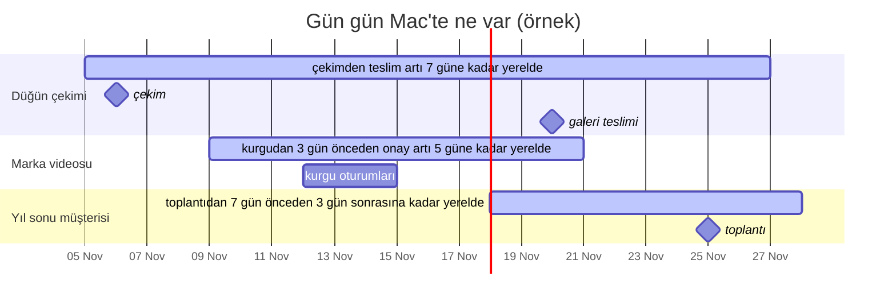

# Evict-Planner


**Verin artık dizüstüne sığmıyor. Hepsine aynı anda ihtiyacın yok — ama her parçasına planlı bir anda,
beklemeden ihtiyacın var.** Evict-Planner, *takvime bağlı bir yerel pencere* taslağıdır: dosyalar sen
ihtiyaç duymadan önce Mac'e iner, çalıştığın sürece kalır, işin bitince iCloud Drive'a ya da bir NAS'a
geri döner.

[English README](README.md)

> **Bu depo nedir:** ana hatları çizen ve fikir veren bir taslak; kur-çalıştır bir ürün değil. Deseni,
> parçaları, macOS'taki yapı taşlarını ve böyle bir sistemi büyük bir arşivde (yüzlerce GB, 100 binden fazla
> dosya) çalıştırırken öğrenilmiş güvenlik kapılarını anlatır. **Kuralları sen yazarsın.** Hedef okur, kendi
> sürümünü yazmak isteyen herkes — bir geliştirici ya da bir yapay zekâ asistanıyla çalışan bir "vibe coder".
> Dört hazır örnek [`examples/`](examples/) klasöründe.

---

## İçindekiler

- [Bu sana göre mi?](#bu-sana-göre-mi)
- [Fikir](#fikir)
- [Dört kişi, tek desen](#dört-kişi-tek-desen)
- [Ne kadar yer açılır?](#ne-kadar-yer-açılır)
- [Nasıl çalışır — tek bir koşu](#nasıl-çalışır--tek-bir-koşu)
- [Takvimi pencereye çevirmek](#takvimi-pencereye-çevirmek)
- [Yedek kopya nerede durur](#yedek-kopya-nerede-durur)
- [Güvenlik kapıları](#güvenlik-kapıları)
- [macOS yapı taşları](#macos-yapı-taşları)
- [Politika dosyası](#politika-dosyası)
- [Yapay zekâ asistanıyla yaz](#yapay-zekâ-asistanıyla-yaz)
- [Sözlük](#sözlük) · [Sınırlar](#sınırlar) · [Benzer çalışmalar](#benzer-çalışmalar-31102026da-bakıldı)

---

## Bu sana göre mi?

Üç soru:

1. **Verin diskini aşıyor mu?** Ham görüntüler, RAW fotoğraflar, müşteri arşivleri, ses kütüphaneleri,
   veri setleri — arşiv, dizüstünün SSD'sinin birkaç katı.
2. **Herhangi bir anda yalnız bir dilimine mi ihtiyacın var?** Bu haftanın projeleri, bu ayın müşterileri —
   on yılın tamamı aynı anda değil.
3. **Bir ritim var mı, ve yazıya dökülebilir mi?** Çekimler, kurgu oturumları, paylaşım tarihleri,
   beyanname günleri, toplantılar, dersler. Bir takvimde — ya da klasör adlarının kendisinde — duruyorsa
   planı o sürebilir.

Üçüne de "evet" diyorsan bu desen sana uyar. Neye ihtiyaç duyacağını önceden **bilemiyorsan** (bir kurgucunun
aklına estikçe stok arşivini karıştırması gibi), bağlantın çoğu zaman yavaş ya da kotalıysa, ya da her şey
zaten diske sığıyorsa uymaz.

---

## Fikir

Arşivinin tam kopyası zaten başka bir yerde duruyor — iCloud Drive'da, bir NAS'ta ya da ikisinde — yani
Mac'in her şeyi tutmasına gerek yok. Yalnız **yakında lazım olacak** olanı tutması gerekiyor; üstelik
**lazım olmadan önce**, ki bir dosyayı açmak hiçbir zaman indirme beklemek ya da trendeyken açamamak
anlamına gelmesin.

Evict-Planner programını her proje, müşteri ya da çekim için bir **yerel pencereye** çevirir:

```
          ön süre (ör. 7 gün)          etkinlik          art süre (ör. 14 gün)
 ─────────[============== bu Mac'te durur ==============]──────────────────▶ zaman
  bulutta     burada indirilir   burada lazım   hâlâ elinin altında   evict → yine bulutta
```

- **Pencere açılmadan önce** dosyalar indirilir (*prefetch*) — henüz iyi bir bağlantıdayken; bir koşu
  kaçsa da sorun olmasın diye tercihen günde birkaç kez.
- **Pencere boyunca** yerelde kalır, internet olmasa bile anında açılır.
- **Pencere kapanınca** *evict* edilir: yerel veri diskten çıkar, dosya Finder'da yer tutucu olarak
  görünmeye devam eder ve çift tıkla geri iner. Hiçbir şey silinmez.
- **Geri kalan her şey** kendi penceresi gelene kadar iCloud'da ve/veya NAS'ta bekler.

Bu gözle bir ay — üst üste binen üç pencere, geri kalan her şey bulutta:



### Neden macOS'un "Mac Depolamasını Optimize Et" özelliği yetmiyor?

macOS iCloud dosyalarını kendisi de evict edebilir, ama kararı **senin planına göre değil, son kullanım
zamanına ve disk baskısına göre** verir. Neyi ne zaman seçtiğini söylemez, yarın lazım olacak dosyayı da
atabilir, "şu klasör asla, şu klasör her zaman, bu dosyalar yalnız etkinliklerinin çevresinde" diye kural
yazamazsın. Evict-Planner kontrolü tersine çevirir: **kararı sen verirsin, araç önce planı gösterir, sonra
uygular.**

---

## Dört kişi, tek desen

Aynı döngü çok farklı işlere hizmet eder. Değişen şey ritim, hep kalması gereken şey ve buluta
gönderilecek kadar ağır olan şeydir.

### 🎬 Video kurgucu

- **Veri:** yükün çoğu kamera orijinalleri — 4K ProRes 422 HQ'da saatte kabaca 300 GB — artı proxy'ler,
  ses, grafikler, proje dosyaları ve çıktılar.
- **Ritim:** çekim günü → kurgu oturumları → renk → müşteri onayı → teslim. Hepsi bir takvimde.
- **Hep yerelde:** proje dosyaları, proxy'ler, grafikler, ses. Proxy'lerle orijinaller buluttayken bile
  kesmeye devam edebilirsin.
- **Pencere:** ilk kurgu oturumundan iki gün önceden bir hafta sonrasına kadar tüm proje klasörü; çıktılar
  yeniden teslim istekleri için teslimden sonra bir ay kalır.
- **Buluta geri:** son oturumdan iki hafta sonra kamera orijinalleri, eski çıktılar, arşive kalkmış projeler.
- **Dikkat:** kurgu kütüphaneleri ve render önbellekleri veritabanıdır — içlerinde asla evict yapma, mümkünse
  senkron klasörlerin tamamen dışında tut. Kurgu programının açık tuttuğu bir dosyayı asla evict etme.
- **Örnek:** [`examples/video-editor.json`](examples/video-editor.json)

### 📱 Sosyal medya içerik üreticisi

- **Veri:** telefon ve kamera klipleri, B-roll, müzik ve ses efektleri, kapak görselleri, marka kiti,
  farklı platformlar için çıktılar.
- **Ritim:** bir içerik takvimi — çekim, kurgu, paylaşım, yorumlara yanıt verilen ilk günler — ve marka
  işbirliklerinin onay turları.
- **Hep yerelde:** marka kiti, şablonlar, LUT'lar, kapak görselleri, her hafta kullandığın müzikler ve
  Finder'da *Evergreen* etiketli B-roll.
- **Pencere:** takvim şart bile değil — her paylaşım klasörünü paylaşım tarihiyle adlandır
  (`2026-11-12 sabah-rutini/`), pencereyi tarihin kendisi açar: bir hafta önce, üç gün sonra. Ayrı bir
  takvim, sponsorun onay turu için bir kurguyu geri getirir.
- **Buluta geri:** paylaşımdan iki hafta sonra ham klipler, bir ay sonra (başka platformlarda da
  paylaşıldıktan sonra) çıktılar, üç aydır etiketlenmemiş B-roll.
- **Dikkat:** "throwback" ve yeniden kurgu günleri de birer takvim etkinliğidir — bir tane ekle, eski klasör
  zamanında geri gelir.
- **Örnek:** [`examples/content-creator.json`](examples/content-creator.json)

### 🧾 Muhasebeci

- **Veri:** her müşteri için yıl başına bir klasör — taranmış fişler, faturalar, banka ekstreleri, bordro,
  verilmiş beyannameler. Çok sayıda küçük dosya, saklanması gereken yılların arşivi.
- **Ritim:** tekrar eden beyanname günleri (aylık, üç aylık, yıllık), müşteri toplantıları, ara sıra geçmiş
  yılları isteyen bir inceleme.
- **Hep yerelde:** her müşterinin içinde bulunulan yılı, şablonlar, tüm küçük metin ve CSV dosyaları.
- **Pencere:** geçen yılın klasörü her beyanname gününden on gün önce geri gelir; bir inceleme, o tek
  müşterinin tüm yıllarını bir aylığına geri getirir.
- **Buluta geri:** eski yıllar, ama yalnız 1 MB'tan büyük dosyalar — binlerce küçük dosyayı evict etmek
  neredeyse hiç yer açmaz, bir sonraki aramayı da yavaşlatır.
- **Dikkat:** beyanname günleri *tekrar eden* etkinliklerdir — takvimi okuyan kod tekrarları açmalıdır.
  Müşteri verisi hassastır: takvim bağlantısı bir sırdır, bildirimler müşteri adı değil yalnız sayı taşır.
- **Örnek:** [`examples/accountant.json`](examples/accountant.json)

### 📷 Profesyonel fotoğrafçı

- **Veri:** RAW dosyalar — bir düğün çoğu zaman 100 GB'ı aşar — `.xmp` yan dosyalarıyla, seçilmişler ve
  dışa aktarılmış JPEG'ler; önizlemeleriyle bir katalog.
- **Ritim:** çekim → aktarma ve eleme → düzenleme → galeri teslimi → albüm provası ve baskı siparişleri.
- **Hep yerelde:** yan dosyalar (birkaç KB, düzenlemeleri tutar), seçilmişler, *Portfolio* etiketli her şey
  ve kataloğun kendisi — dahili diskte, senkron klasörün dışında.
- **Pencere:** çekim klasörü tarihle adlandırılır (`2026-11-06 Ece-Mert Dugun/`), pencere çekimden bir gün
  önce açılır ve üç hafta sürer; teslim takvimi çekimi albüm ve baskı turları için geri getirir.
- **Buluta geri:** çekimden bir ay sonra RAW'lar. Lightroom Classic'in Akıllı Önizlemeleri (Smart Previews)
  ile orijinaller Mac'ten gittikten sonra da düzenlemeye devam edebilirsin.
- **Dikkat:** tam çözünürlüklü dışa aktarma orijinali ister — baskı siparişini ya da albüm turunu takvime
  yaz ki RAW'ları önce prefetch geri getirsin.
- **Örnek:** [`examples/photographer.json`](examples/photographer.json)

### …ve aynı biçimdeki diğerleri

| Kim | Ağır veri | Ritim |
|---|---|---|
| Müzisyen, podcast'çi, prodüktör | çok kanallı kayıtlar, sample kütüphaneleri | provalar, kayıt ve miks oturumları, yayın tarihleri |
| Mimar, 3B sanatçı | modeller, dokular, render'lar | müşteri sunumları, yarışma teslimleri |
| Araştırmacı, veri bilimci | veri setleri, model kontrol noktaları | planlı analizler, teslim tarihleri |
| Avukat | dava dosyaları, taranmış deliller | duruşmalar, süre bitimleri |
| Öğretmen, eğitmen | kayıtlı dersler, ders materyali | ders programı |
| Klinik, muayenehane, danışmanlık ofisi | kişi kayıtları, görüntüleme | randevular ve kontroller |

---

## Ne kadar yer açılır?

Mac herhangi bir anda şunu tutar:

```
bugün yerelde  ≈  hep yerelde kalanlar  +  Σ (penceresi bugünü kapsayan her öğenin boyutu)
```

Ortalamaya göre değil, yılın **en yoğun** gününe göre hesapla ve yarının pencerelerinin indirilmesi için
pay bırak.

**İşlenmiş bir örnek** (sayılar temsilî): 120 müşterili, müşteri başına 8 GB arşivi olan bir muhasebe
bürosu — toplam 960 GB.

| Parça | Kural | Yerelde |
|---|---|---|
| Her müşterinin içinde bulunulan yılı | hep yerelde, her biri ~1 GB | ~120 GB |
| Beyanname penceresindeki müşteriler | aynı anda ~10, her biri geçen yıldan ~1 GB | ~10 GB |
| Bir inceleme | tek müşteri, tüm yıllar | ~8 GB |
| **Kararlı durum** | | **960 GB yerine ~140 GB** |

---

## Nasıl çalışır — tek bir koşu

```
 takvim ──► [bugün − art süre, bugün + ön süre] aralığındaki etkinlikler
                   │
                   ▼
 her etkinliği klasör(ler)le eşle ──► eşleşmeyen yaklaşan etkinlik var mı? → uyarı
                   │
                   ▼
 senin politikan (ilk eşleşen kural kazanır, varsayılan = koru)
     ├─► YERELDE KALACAKLAR ──► henüz inmemiş mi? → İNDİR (en yakın etkinlik önce)
     └─► EVICT ADAYLARI ──► (isteğe bağlı) ikinci kopya NAS'ta doğrulandı mı?
                                     │
                                     ▼
                              güvenlik kapıları ──► evict ──► gerçekten oldu mu? ──► rapor
```

1. **Kaynakları oku.** Bir takvim (ICS bağlantısı, CalDAV, Google Takvim, Apple Takvim…) ve isteğe bağlı
   olarak klasör adlarındaki tarihler ya da kendi küçük tablon. **Fail-closed:** takvim okunamıyorsa hiçbir
   şey evict edilmez — boş bir takvim her dosyayı gereksiz gösterir.
2. **Etkinlikleri klasörlerle eşle** (sonraki bölüm). **Hiçbir klasörle eşleşmeyen yaklaşan etkinlik**
   uyarıyı hak eder: indirilmeyecek dosya tam olarak odur.
3. **Politikanı uygula.** Sıralı bir kural listesi; **ilk eşleşen kural kazanır**, **hiçbir kuralın
   söylemediği şey korunur**.
4. **İndir:** yerelde kalması gereken ama hâlâ bulutta olanları, en yakın etkinlikten başlayarak. Bu adım
   NAS gerektirmez, her yerde koşabilir; günde birkaç kez çalıştır.
5. **(İsteğe bağlı, önerilir) Evict'ten önce yedekle.** İkinci kopyan NAS ise, evict ancak o kopya
   **doğrulandıktan** sonra serbesttir: `rsync` ile kopyala, boyutu **ve sağlama toplamını kaynakla**
   karşılaştır (yalnız NAS'tan geri okunan sağlama toplamı hiçbir şey kanıtlamaz), bir manifest ya da
   klasör başına özet ağacı tut ve **NAS'ta asla silme** — üzerine yazılan sürümleri bir sürümler klasörüne
   taşı.
6. **Evict et:** aşağıdaki kapıların hepsinden geçen adayları, koşu başına bir tavanla.
7. **Doğrula ve raporla.** Her evict'in gerçekten olduğunu kontrol et, yalnız eklenen (append-only) bir
   defter tut ve özeti bir insanın göreceği bir kanala gönder (kimsenin açmadığı bir log dosyası değil,
   telefona düşen bir bildirim).

---

## Takvimi pencereye çevirmek

### Plana kendi takvimini ver

Ayrı bir takvim (ya da birkaç tane: *Kurgu*, *Teslim*, *Beyanname*) aç ki kişisel takvimindeki bir diş
randevusu 200 GB indirmesin. Her takvimin kendi ön ve art süresi olabilir.

### Bir etkinliği bir klasörle eşlemek

| Yöntem | Nasıl | Sağlamlık |
|---|---|---|
| **Etkinlik notunda klasör adı** | `folder: 2026-11 Acme Marka Filmi` gibi bir satır | en iyisi — açık, etkinlik adı değişse de çalışır |
| **Eşleme tablosu** | etkinlik başlıklarını ya da müşteri kodlarını klasörlere bağlayan bir CSV | çok müşterili tekrar eden beyannameler için iyi |
| **Başlık klasör adını içeriyor** | bulanık; iki tarafı normalize et | pratik, ama "Demir"in üç klasörle eşleşmesine dikkat |
| **Klasör adında tarih** | `2026-11-06 Ece-Mert Dugun/` kendi penceresini açar | hiç takvim yok — çekimler ve paylaşımlar için ideal |
| **Finder etiketi** | *Evergreen* ya da *Portfolio* gibi bir etiket | takvimi hiç umursamayan şeyler için |

Karşılaştırmadan önce normalize et: Unicode NFC (macOS dosya adlarını NFD döndürür), büyük/küçük harf ve
dile özgü harfler (Türkçede `ı/I` ve `i/İ` İngilizcenin beklediği gibi dönüşmez).

### Takvimde canını yakacak ayrıntılar

- **Tekrar eden etkinlikler** (`RRULE`) açılmalıdır — aylık bir beyanname günü on iki etkinlik değil, kuralı
  olan tek bir etkinliktir. Tekrarları ve istisnaları açan bir kütüphane kullan.
- **İptal edilen etkinlikler** (`STATUS:CANCELLED`) pencere açmamalı; **taşınan etkinlikler** pencereyi de
  taşımalı.
- **Tüm gün etkinlikleri ve saat dilimleri:** tarihleri UTC'ye göre değil, yerel saat dilimine göre
  karşılaştır.
- **Gizli bağlantılar sırdır.** Google Takvim'in "iCal biçiminde gizli adres"i ya da yayımlanmış bir takvim
  adresi, elinde olan herkese okuma izni verir — depoya da günlüklere de girmesin.
- **Takvim uygulaman yok mu?** Anımsatıcılar'daki bitiş tarihleri, bir proje aracının API'si ya da düz bir
  CSV de aynı işi görür — motorun ihtiyacı yalnız `(tarih, klasör)` çiftleri.

---

## Yedek kopya nerede durur

| Mod | İkinci kopya | "Evict" ne demek | "İndir" ne demek | Risk |
|---|---|---|---|---|
| **A · iCloud Drive** | iCloud | dosya yer tutucuya döner (dataless) | `brctl download` / Foundation API | iCloud senkrondur, yedek değil: orada silinen burada da gider |
| **B · iCloud + NAS** *(önerilen)* | iCloud **ve** doğrulanmış NAS kopyası | A gibi, ama ancak NAS kopyası doğrulandıktan sonra | A gibi | en düşük |
| **C · Yalnız NAS ya da harici disk** | NAS | çift doğrulanmış kopyadan sonra yerel kopya **silinir** | `rsync` ile geri | en yüksek — yer tutucu yok, geri alma yok |

C modu gerçek silmedir. Kuracaksan: iki kez doğrula (önce kaynağa karşı sağlama toplamı, sonra NAS
kopyasını taze okuyarak), tek doğrulamayla asla silme, her klasöre neyin nereye gittiğini listeleyen küçük
bir `OFFLOADED.txt` yaz ve manifesti dizüstünden başka bir yerde tut.

Apple'ın File Provider altyapısı üzerine kurulu diğer bulut istemcileri (Dropbox, OneDrive, Google Drive) de
"yalnız çevrimiçi" yer tutucular bırakır ve aşağıdaki dataless denetimi çoğunlukla onlarda da çalışır — ama
evict ve indirme komutları farklıdır. Güvenmeden önce her istemciyi ayrıca dene.

---

## Güvenlik kapıları

Bunlar hayal edilmiş değil, ölçülmüş hatalardan çıktı. Bunları atlayan ev yapımı bir evict aracı er geç ya
bir şeyin tek kopyasını siler ya da başarı raporlarken sessizce hiçbir şey yapmaz.

| Kapı | Neden |
|---|---|
| **Varsayılan koru** | Hiçbir kuralın söylemediği yola dokunulmaz. Kurallardaki sessiz bir boşluk veriye değil, disk alanına mal olmalı. |
| **Önce kuru koşu, her koşuya tavan** | Planı göster; yalnız açık bir bayrakla uygula. Tek koşunun evict edebileceği GB'yi sınırla. |
| **Yalnız tam yüklenmiş dosyayı evict et** | Henüz yüklenmemiş dosyanın tek kopyası Mac'tedir. `NSURLUbiquitousItemIsUploadedKey` = true, `…IsUploadingKey` = false, `…HasUnresolvedConflictsKey` = false olmalı; durum okunamıyorsa **atla**. ⚠️ `brctl status <dosya>` bunu **söylemez**: konteyner adı alır, dosya yolu verilince "Client zone not found" yazar ve yine de 0 ile çıkar. |
| **Çıkış kodu 0'a güvenme** | `brctl evict`, iCloud senkronla meşgulken 0 dönüp hiçbir şey yapmayabilir. Bir ölçümde "başarılı" evict'lerin **%47'si** hâlâ diskteydi. Tek kanıt, sonrasında taze bir `lstat`'te `st_blocks == 0` görmektir. Kalanları birkaç saniye arayla birkaç tur yeniden dene. |
| **"İndirilmiş Tut"a saygı** | Finder'da *İndirilmiş Tut* işaretli bir klasör `com.apple.fileprovider.pinned#PX` xattr'ını taşır ve altındaki her şey bunu miras alır. Orada evict boşa iştir: macOS dosyayı dakikalar içinde yeniden indirir. Atla ve uyar. |
| **Açık dosyaları ve paketleri atla** | Bir uygulamanın açık tuttuğu dosyayı evict etme (`lsof`). Paketleri ve veritabanlarını — kurgu kütüphaneleri, fotoğraf katalogları, uygulama paketleri — tek bir birim say ya da tamamen dışarıda bırak. |
| **Uygulamadan hemen önce yeniden bak (TOCTOU)** | Boyut, değişiklik zamanı ve pin durumu planla evict arasında değişebilir. Her evict'ten hemen önce yeniden oku. |
| **Fail-closed ve kesik kaynaklar** | Takvim yok → evict yok. Son iyi okumaya göre birden çok daha az etkinlik dönen takvim tatil değil, *şüphelidir*: son iyi kopyaya dön ve evict'i ertele. |
| **Dosya taramasında sayım kapısı** | iCloud klasör listelemesi yarım dönebilir. Tarama öncekinden çok daha az dosya görüyorsa dur. **Bir** taramada görünmeyen dosya gitmiş değildir — iki ardışık tarama iste. |
| **Yerel kümeyi izle** | Yerelde kalması gereken dosyaların kümesi son koşuya göre bir eşikten fazla küçülürse sebepleriyle uyar — genelde bozuk bir kural ya da bozuk bir kaynaktır. |
| **Bilinmeyeni karantinaya al** | Yeni bir dosya adı türü (yeni bir önek, yeni bir uzantı) birkaç gün evict edilmez ve sana haber verilir. |
| **Ağ farkındalığı** | NAS'a yalnız ev ağında yedekle; ev ağını bir kafedeki modemin de dağıtabileceği IP'yle değil, NAS'ın **MAC adresiyle** tanı. Telefon hotspot'unda ağır işi atla. |
| **Uykuya dayanıklı zamanlama** | `launchd` ile `StartCalendarInterval` (uykuda kaçan koşu uyanınca telafi edilir) ve koşunun çevresinde `caffeinate -i`. Bir ölü adam anahtarı ekle: "3 gündür başarılı koşu yok" da bir uyarıdır. |
| **Kalıcı ve bilinen hatalar ayrı bir sınıftır** | Bazı dosyalar hiç yedeklenemez (bkz. *Sınırlar*: iCloud'un indirmediği etiketli dosyalar). "Bekleyen" sayılırlarsa hiçbir koşu başarılı olmaz: kısa yeniden deneme aralığı devreye girer, her koşu uyarı gönderir, birkaç gün sonra ölü adam anahtarı her gün öter — gerçek bir arıza bu gürültüde kaybolur. Onları ayrı say, göstermeye devam et, yalnız sayıları **artınca** uyar. Başka bir yerden tamamlanmış bir kopyası yedekte aynı yol ve boyutta duruyorsa dosyayı yedekli say — kaynakla doğrulanmadığı işaretiyle. |
| **İçeriksiz bildirim** | Özet "412 dosya, 38 GB evict edildi" der; hangi müşteri ya da proje olduğunu söylemez. Bildirim servisleri üçüncü taraftır. |

### NAS'a özgü tuzaklar

- **Büyük/küçük harf ve dil katlaması farklıdır.** Bir SMB sunucusu iki adı aynı dosya sayarken APFS
  farklı sayabilir (ör. Türkçe `ı`/`I`: APFS `ı`'yı katlamaz, büyük harfle karşılaştıran bir Samba sunucusu
  katlar). macOS SMB istemcisi ikinci adı "yok" gösterir ama yazma ilk dosyaya gider; böylece her koşu bir
  dosyayı ötekinin üstüne yazar ve doğrulama hiç geçmez. Kopyalamadan önce bu çakışmaları yakala (her klasörde
  NFC'ye çevrilmiş, büyük harfli ada göre grupla), ikinci dosyayı bir takma adla gönder (`--files-from` yeniden
  adlandıramaz — onu tek başına kopyala) ve takma adı manifeste yaz ki doğrulama, evict ve taşıma takibi onu kullansın.
- **NAS'ta aynı anda tek ağır iş.** Aynı SMB sunucusundaki ikinci bir iş — md5 bile yapmayan, yalnız listeleyip
  yeniden adlandıran — yüklemeyi yaklaşık 26 MB/sn'den 2–4 MB/sn'ye düşürdü; iş duraklatılınca hız hemen geri
  geldi. Bunu bir notla değil kodla sağla (yan işin kontrol edip yol verdiği ortak bir kilit).
- **Yalnız bulutta duran dosyaları yedeklemek bir boru hattıdır.** Evict edilmiş dosyalar kopyalanmadan önce
  iCloud'dan inmelidir. Partilerle çalış (ör. 20 GB): *n*. parti md5'lenip kopyalanırken *n + 1*. partiyi indir,
  sonra *n*. partiyi arka planda birkaç işçiyle yeniden evict et. Dosyaları tek tek yeniden evict etmek (dosya
  başına ~0,5 sn) NAS'ı her partide 20–35 dakika boş bıraktı; 8 işçi yaklaşık 6 kat hızlıydı. Yeniden evict
  hiçbir şey yüklemez — yalnız yerel kopyayı atar.
- **Aynı klasöre paralel yeniden adlandırma başarısız olabilir.** Her biri geçici bir ada yazıp aynı klasöre
  yeniden adlandıran sekiz kopyalama işçisi, bir SMB paylaşımında yeniden adlandırmaların yaklaşık %2'sinde
  `EIO` aldı; bunlar tek tek yeniden denenince geçti. Geçici dosyayı bırak, raporla, sırayla yeniden dene.
- **`rsync --files-from`** `#` ile başlayan satırları yorum sayar. Her yolun başına `./` koy.
- **rsync 3.x kullan** (ör. Homebrew'dan). macOS'la gelen `rsync` aslında `openrsync`'tir ve yalnız eski
  2.6.9 protokolünü konuşur.
- **Taşıma ve yeniden adlandırmaları izle** (aynı boyut + nanosaniye mtime), ki bir klasörü yeniden
  düzenlemek onu baştan yüklemek anlamına gelmesin.
- **Bağlantı hatası, eksik dosya değildir.** Yalnız "dosya yok" eksik sayılır; kopan bir SMB oturumu
  kayıtlarını silmemeli.

---

## macOS yapı taşları

| İhtiyaç | Yapı taşı |
|---|---|
| Dosya yerelde mi, yalnız bulutta mı? | `lstat`: `st_flags & SF_DATALESS (0x40000000)` ya da `st_blocks == 0 && st_size > 0` |
| Tam yüklendi mi? | Yukarıdaki Foundation URL kaynak anahtarları. Python'dan bağımlılıksız: `osascript -l JavaScript` + `ObjC.import("Foundation")`, tek çağrıda çok yol |
| Evict | `brctl evict <yol>` ya da `FileManager.evictUbiquitousItem(at:)` |
| İndir | `brctl download <yol>` ya da `FileManager.startDownloadingUbiquitousItem(at:)` |
| iCloud bunu hiç indirir mi? | `com.apple.quarantine` xattr'ındaki kaynak (üçüncü alan: dosyayı kaydeden uygulama) ve `com.apple.macl` xattr'ı; ikisi de `getxattr` ile okunur (dosyayı açmaz, indirme tetiklemez); `fileproviderctl evaluate <yol>` `isDownloadRequested` / `isDownloaded` / `isUploaded` gösterir — bkz. *Sınırlar* |
| Pinli mi (İndirilmiş Tut)? | Öğenin kendisinde ya da bir üst klasörde `com.apple.fileprovider.pinned#PX` xattr'ı |
| Finder etiketleri | `com.apple.metadata:_kMDItemUserTags` xattr'ı (etiket adlarından oluşan ikili bir plist) |
| Bir uygulama açık tutuyor mu? | yol üzerinde `lsof` |
| Tekrar eden etkinlikler | `RRULE`'ü ve istisnaları açan bir iCalendar kütüphanesi |
| Zamanlama | `launchd` + `StartCalendarInterval`, `caffeinate -i` |
| Bildirim | herhangi bir anlık bildirim kanalı (ntfy, Pushover, Bark, …) |

> `brctl download` ve `brctl evict` yeni macOS sürümlerinde `brctl` yardımında artık görünmüyor ama hâlâ
> çalışıyor. Ucuz test: birini iCloud dışındaki bir yolla çağır — "Path is outside of any CloudDocs app
> library" komutun var olduğunu, "No such operation" kaldırıldığını gösterir. Apple kaldırırsa yol,
> yukarıdaki Foundation API'leridir.

---

## Politika dosyası

Politika, sana ait olan kısımdır. [Örnekler](examples/) şu biçimi kullanıyor — bir öneri, standart değil:

```json
{
  "roots": ["~/Library/Mobile Documents/com~apple~CloudDocs/Isler"],
  "calendars": [
    { "name": "work", "source": "ics", "url": "<takviminin gizli ICS bağlantısı>",
      "lead_days": 7, "tail_days": 14,
      "match": { "by": "folder-in-notes", "prefix": "folder:" } }
  ],
  "rules": [
    { "pattern": "**/*.txt",   "action": "keep",  "note": "küçük, hep işe yarar" },
    { "tag": "Evergreen",      "action": "keep" },
    { "calendar": "work",      "action": "keep" },
    { "pattern": "Arsiv/**",   "action": "evict" },
    { "pattern": "**/*.mov",   "action": "evict", "min_age_days": 30 }
  ],
  "max_evict_gb_per_run": 50,
  "min_free_gb": 100
}
```

| Alan | Anlamı |
|---|---|
| `roots` | planlayıcının dokunabileceği klasörler; dışındaki hiçbir şey okunmaz, evict edilmez |
| `calendars[].lead_days` / `tail_days` | bir etkinlikten ne kadar önce ve sonra klasörü yerelde kalır |
| `calendars[].match.by` | `folder-in-notes`, `lookup-csv`, `title-contains-folder` |
| `rules[].pattern` | köke göreli desen; `*` tek klasörün içinde kalır, `**` istediği kadar klasörü (hiç dahil) geçer, `{a,b}` ikisinden biri; Mac'in varsayılan diski gibi büyük/küçük harfe duyarsız |
| `rules[].tag` | bir Finder etiketi |
| `rules[].calendar` (+ `inside`) | o takvimdeki bir etkinliğin eşlediği klasörü — ya da yalnız `inside` ile verilen kısmını — tut |
| `rules[].date_from_name` | eşleşen klasörün adından `YYYY-MM-DD` tarihini oku ve çevresinde bir pencere aç |
| `rules[].min_age_days`, `min_size_mb` | kuralın uygulanması için ek koşullar |
| `rules[].action` | `keep` ya da `evict`; **ilk** eşleşen kural kazanır, eşleşme yoksa `keep` |
| `{year}`, `{year-1}` | politika yüklenirken içinde bulunulan ve önceki yılla değiştirilir |
| `max_evict_gb_per_run` | koşu başına tavan |
| `min_free_gb` | isteğe bağlı hedef: bu kadar boş yer açılınca evict durur |

Sıra önemlidir: koruma kurallarını üste yaz.

---

## Yapay zekâ asistanıyla yaz

Asistana bu README'yi, klasör düzenini ve örneklerden birini ver, sonra şuna benzer bir şey söyle:

> *`<kök>` altındaki klasörleri, `<takvim>`'deki etkinliklerden N gün önce M gün sonrasına kadar yerelde
> tutan, geri kalan her şeyi iCloud Drive'dan evict eden bir macOS aracı yaz. Bu README'nin "Güvenlik
> kapıları" bölümüne uy. Salt-okunur bir rapor ve planı yazdıran bir kuru koşuyla başla; `--uygula`'yı
> ancak ben planı inceledikten sonra ekle. Kurallarım şunlar: …*

Bu sırayla kur ve bir sonrakine geçmeden her adımla birkaç gün yaşa:

1. **Salt-okunur rapor** — en üst klasör başına ne yerelde, ne bulutta.
2. **Kuru koşu planı** — hangi dosya kalır, hangisi gider ve *hangi kural karar verdi*.
3. **İndirme** — zararsızdır: yalnız indirir.
4. **Tüm kapılarla evict** — başta küçük bir tavanla.
5. **Zamanla ve bildir** — `launchd`, telefonuna bir özet, bir ölü adam anahtarı.
6. **NAS yedeği** — yalnız B ya da C modunu istiyorsan.

---

## Sözlük

| Terim | Anlamı |
|---|---|
| **Evict** | Dosyanın yerel verisini kaldırıp bulutta tutmak; Finder onu göstermeye devam eder |
| **Dataless / yer tutucu** | Adı ve üst verisi diskte olan ama içeriği olmayan dosya |
| **Prefetch (önceden indirme)** | İhtiyaçtan önce indirmek |
| **Pencere** | Bir etkinlikten *ön süre* önce *art süre* sonrasına kadar, klasörün yerelde kaldığı dönem |
| **Pin / İndirilmiş Tut** | Finder'ın bir klasörü yerelde tutan işareti; altında evict edilen dosyayı macOS geri indirir |
| **Fail-closed** | Emin değilsen güvenli olanı yap — burada: evict etme |

## Sınırlar

- Evict **yerel diskte** yer açar, iCloud depolama kotasında değil.
- Bir dosya iCloud'dan silinirse yereldeki yer tutucusu da gider. iCloud bir senkron hizmetidir, yedek
  değildir — bağımsız bir ikinci kopya tut (NAS adımı bunun için var).
- Fotoğraflar kütüphanesi ayrı bir dünyadır; onun için Fotoğraflar'ın kendi "Mac Depolamasını Optimize
  Et" ayarını kullan.
- `brctl` belgelenmemiştir; davranışı macOS sürümleri arasında değişebilir.
- **Bazı evict'li dosyalar geri inmez.** Korumalı alanda çalışan bir mesajlaşma uygulamasının iCloud Drive'a
  kaydettiği dosyalar (`com.apple.quarantine`'in üçüncü alanında o uygulamanın adı yazar; çoğunda
  `com.apple.macl` de vardır) hiçbir yolla inmedi: `brctl download`, `startDownloadingUbiquitousItem`, Finder'ın
  **Şimdi İndir** komutu ve dosyayı Önizleme'de açmak — dördünde de `fileproviderctl evaluate <yol>` çıktısında
  `isDownloadRequested = 0` kaldı (istek kaydedilmedi bile), dosyayı okumak `EPERM` verdi; oysa `isUploaded = 1`
  içeriğin iCloud'da olduğunu gösteriyordu. Belirleyici etiket değil, kaynaktır: o kaynaktan gelen birkaç
  etiketsiz dosya da takıldı; başka kaynaklı (AirDrop, Önizleme, Fotoğraflar, ekran görüntüsü, karantina kaydı
  olmayan) etiketli dosyaların hepsi indi — **ekran kilitliyken de** (kilidi işaret eden önceki 3 dosyalık deneme
  küçüktü). Arşivin yaklaşık %1'i. Yani: kaynağa göre karar ver, bu dosyaları indirme kuyruğuna koyma (her biri
  zaman aşımı boyunca bir indirme yerini tıkar), ayrı say ve başka bir kopyadan tamamla (sonraki madde).
- **iCloud'un geri vermediğini tamamlamak.** Başka kopyalara bak: eski bir yedek (yol + boyut eşleşmesi —
  değişiklik tarihleri o yedeğin kopyasında korunmamış olabilir) ve telefonun yerel yedeği (mesajlaşma
  uygulaması asıl medyayı tutar; şifresiz bir iOS yedeğinde dosya `<ilk 2 hex>/<"<alan>-<göreli yol>"un SHA-1'i>`
  yolundadır, uygulamanın mesaj veritabanı medya yolunu ve tam boyutunu verir). Kopyala, kopyadan sonra
  özetle doğrula ve manifest kaydını *ad + boyutla eşleşti, kaynakla doğrulanmadı* diye işaretle ki asıl dosya
  okunabilir olduğunda sonraki bir denetim kıyaslayabilsin. Kurtarılan kopyayı asla iCloud klasörüne geri yazma.
- **Finder'ın ve Spotlight'ın burada kendi sınırları var.** Finder **Şimdi İndir**'i yalnız normal bir klasör
  penceresinde gösterir; Akıllı Klasör ya da arama sonucundaki dosyalarda göstermez. Birkaç yüz `||` koşullu bir
  Spotlight ham sorgusu çalışır; 400 ile 600 arasında bir yerde sessizce bozulur (sonuç yerine sorgu metnini
  döndürdü) — sorguyu böl.
- Pencere ancak takvim doğruysa işe yarar. Unutulmuş bir etkinlik, o gün indirme beklemek demektir.

## Benzer çalışmalar (31.10.2026'da bakıldı)

Her biri açılıp okundu. Hiçbiri takvime ya da kurallara göre plan yapmıyor — bu taslağın doldurduğu
boşluk bu.

- [icanhasjonas/icloud-tools](https://github.com/icanhasjonas/icloud-tools) — Swift CLI: durum, indirme,
  evict, pin, kuru koşuyla; Foundation API'lerini kullanır. Üzerine inşa etmek için iyi bir temel katman.
- [chid/icloud-space-browser](https://github.com/chid/icloud-space-browser) — büyük dosyalar için etkileşimli
  terminal tarayıcısı, onayla evict eder.
- [xPolar/evict-icloud](https://github.com/xPolar/evict-icloud) — Rust CLI, kuru koşulu özyinelemeli evict.
- [rishmadaan/Evict-iCloud](https://github.com/rishmadaan/Evict-iCloud) — `FileManager.evictUbiquitousItem`
  etrafında sürükle-bırak uygulaması.
- [Obbut/iCloud-Control](https://github.com/Obbut/iCloud-Control) — ilk Finder eklentisi; macOS'a "İndirmeyi
  Kaldır" gelince emekliye ayrıldı.

## Lisans

[MIT](LICENSE)
